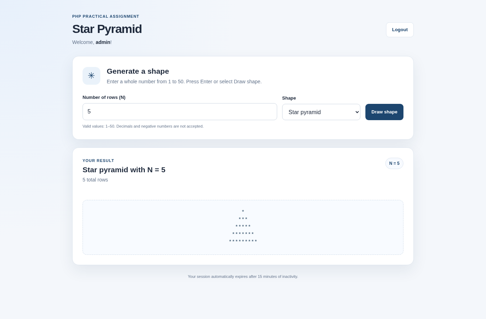
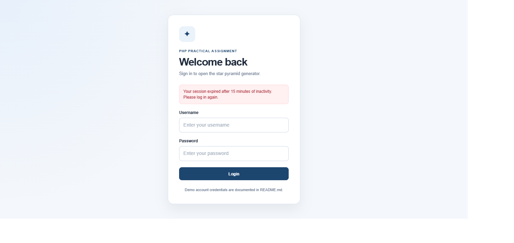

# PHP Login and Star Pyramid Generator

A small web application built with PHP 8+, HTML, CSS, and JavaScript. Users sign in with a demo account and can generate star pyramids using a whole number from 1 to 50. No framework or database is required.

## Features

- Login page with username and password verification.
- Protected pyramid page and logout functionality.
- Star pyramid, inverted pyramid, and diamond shapes.
- Input validation for whole numbers between 1 and 50.
- Pyramid results update without a full page reload using JavaScript `fetch()`.
- Session-based authentication with a 15-minute inactivity timeout.
- Hashed demo password, CSRF-token checks, escaped output, and session ID regeneration after login.
- Responsive layout for desktop and smaller screens.

## Demo Credentials

| Field | Value |
| --- | --- |
| Username | `admin` |
| Password | `admin123` |

The demo password is stored as a hash in `auth.php` and verified with PHP's `password_verify()` function.

## Requirements

- PHP 8.0 or later
- A web browser

XAMPP can be used to provide PHP. MySQL is not required.

## Run Locally

### Option 1: PHP built-in web server

1. Extract the project and open a terminal in the `php-login-pyramid` directory.
2. Start the server:

   ```bash
   php -S localhost:8000
   ```

   On Windows with a default XAMPP installation, you can use:

   ```powershell
   C:\xampp\php\php.exe -S localhost:8000
   ```

   If XAMPP is installed in a different location, update the path to `php.exe`.

3. Open <http://localhost:8000> in your browser.

Keep the terminal open while using the application.

### Option 2: XAMPP Apache

1. Copy the `php-login-pyramid` directory into `C:\xampp\htdocs\`.
2. Start **Apache** in the XAMPP Control Panel. MySQL can remain stopped.
3. Open <http://localhost/php-login-pyramid/> in your browser.

## Screenshots

### Login Page


### Star Pyramid (N = 5)



### Session Expired



## Project Structure

```text
php-login-pyramid/
├── screenshots/
│   ├── login-page.png
│   └── pyramid-n5.png
│   └── session-expired.png
├── index.php       # Login form and credential verification
├── auth.php        # Session, authentication, CSRF, and escaping helpers
├── pyramid.php     # Protected page, validation, shape logic, and JavaScript
├── logout.php      # Clears the session and logs out
├── style.css       # Page layout and responsive styles
└── README.md
```

## Shape Logic

- **Star pyramid:** row `i` contains `2 * i - 1` stars.
- **Inverted pyramid:** rows are generated in reverse order.
- **Diamond:** an upright half followed by a matching lower half, for a total of `2 * N - 1` rows.

The PHP code uses loops to build the spaces and stars; it does not use `str_repeat()` for generating the shape.

## Validation and Security

- Only authenticated users can access the pyramid page.
- Login credentials are checked using a password hash.
- The session ID is regenerated after a successful login.
- Login and pyramid form submissions include CSRF tokens.
- User-provided values displayed in HTML are escaped with `htmlspecialchars()`.
- The row count must be a whole number from 1 to 50, and only supported shape options are accepted.
- Sessions expire after 15 minutes of inactivity. The server checks the timeout, and a browser-side timer redirects the user after inactivity.
- Session cookies use `HttpOnly` and `SameSite=Lax` settings; the `Secure` flag is enabled when the app is served over HTTPS.

## Assumptions

- For the optional diamond shape, N represents the height of the upper half, so the total height is 2 × N − 1 rows.
